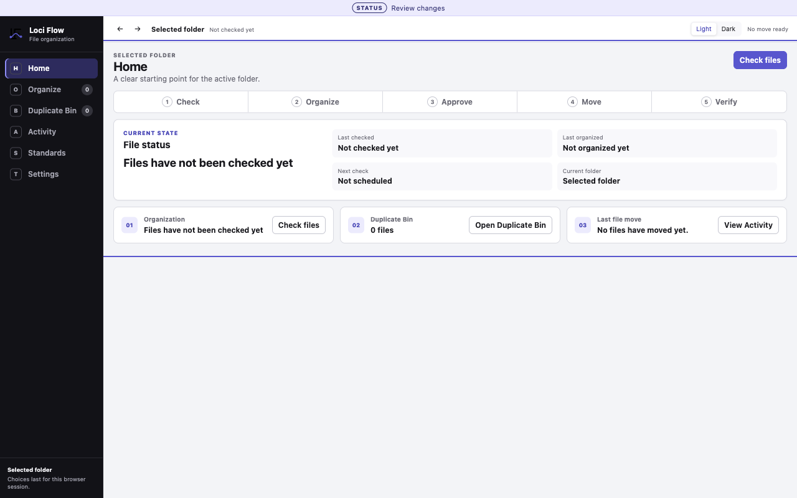

# Loci Flow

Loci Flow is a cautious local file organizer. It scans a folder you choose, suggests where files could go, and moves anything only after you approve the exact plan and confirm it.



## Safety

- Scanning and reports are read-only. Nothing moves until you approve a plan and type its exact confirmation.
- Duplicate files are kept in reversible protected storage. Loci Flow never permanently deletes files.
- Every real move writes an operation log, and Undo reverses logged moves.
- Everything runs on your computer. The web app binds to `127.0.0.1` only, and no cloud service or API key is needed.

## Install

Use Python 3.13 or newer. The command-line tool has no required third-party packages. The web app needs its optional extras:

```bash
git clone https://github.com/yanqinwang-cs/LociFlow.git
cd LociFlow
python3 -m pip install -e ".[web]"
```

## Quickstart

Open the web app on one folder. It opens in your browser and only that folder is used:

```bash
PYTHONPATH=src python3 -m organizer.web --root "$HOME/Downloads"
```

Or write HTML and JSON reports into the folder's `AI_Review` directory from the command line. Reports never move files:

```bash
PYTHONPATH=src python3 -m organizer.cli /path/to/folder --html-report
```

Try these on a small disposable folder first.

## Test and lint

```bash
PYTHONPATH=src python3 -m unittest discover -s tests
```

The suite needs the `web` and `web-test` extras, and the macOS launcher tests need `macos-launcher` and `macos-build`. For a development setup with the pinned linter:

```bash
uv sync --extra web --extra web-test
uv run ruff check .
uv run ruff format --check .
```

GitHub runs the same tests and lint on every pull request.

## Documentation

- [Documentation index](docs/README.md)
- [CLI reference and command list](docs/CLI_REFERENCE.md)
- [Safety constitution](docs/SAFETY.md)
- [Local web architecture](docs/WEB_ARCHITECTURE.md)
- [Report format](docs/REPORT_FORMAT.md)
- [Development guide](docs/development/DEVELOPMENT_GUIDE.md)

## License

Loci Flow is released under the [MIT License](LICENSE).
